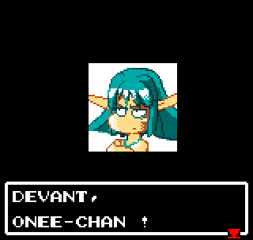
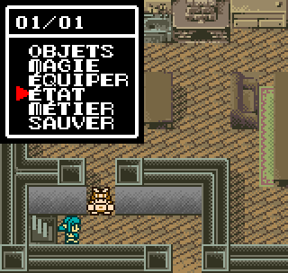

# Nige-Ron-Pa — traduction française

**Nige-Ron-Pa** (Neo Geo Pocket Color, Dennou Eizo, 1999), entièrement en français :
dialogues (relus sur le japonais), menus, combats, boutiques, objets, techniques, métiers,
biographies des personnages, missions et générique.

<p align="center">
  
  
</p>

- **Partie 1 (français)** : jouer en français — le patch et comment l'appliquer.
- **Part 2 (English)** : the translation kit — tools and guide to translate the game into another language.

---

# Partie 1 — Jouer en français

## 1.1 Ce qu'il vous faut

Le patch : `patch/Nige-Ron-Pa_FR_v1.0.ips`.

**Votre propre** copie de la cartouche **japonaise**, non modifiée et sans en-tête (le patch
s'applique directement sur elle : inutile de passer par la version anglaise). Aucune ROM n'est
fournie ici. Vérifiez-la :

| | ROM d'origine attendue |
|---|---|
| Nom | `Nigeronpa (Japan).ngc` |
| Taille | 1 048 576 octets |
| CRC32 | `3CC3E269` |
| MD5 | `9c73091689138179323ff48b279f8b1e` |
| SHA-1 | `b5d355ea808dd01cf746daef7704e54d7766bd3b` |

Avec une autre ROM (déjà modifiée, version anglaise, autre dump), le patch donnera un jeu cassé.

## 1.2 Méthode A — patch appliqué à la volée par l'émulateur

L'émulateur applique le patch en mémoire à chaque lancement : la ROM d'origine n'est **pas
modifiée**. Posez le fichier `.ips` à côté de la ROM, **sous le même nom**, puis lancez la ROM
japonaise normalement :

```
Nigeronpa (Japan).ngc
Nigeronpa (Japan).ips
```

- **NgpCraft Emulator** : vérifié (la ROM obtenue en mémoire a le CRC32 `878EA865`). La ROM
  patchée étant en lecture seule, la sauvegarde va dans un fichier `.flash` à côté du jeu.
- Ce patch **agrandit** la ROM (1 Mio → 2 Mio). Les autres émulateurs qui appliquent un IPS à la
  volée (RetroArch / Beetle NeoPop, Mednafen) n'ont pas été testés : en cas de souci, utilisez la
  méthode B.

## 1.3 Méthode B — créer une ROM française (console, ou tout autre émulateur)

Fabriquez une fois pour toutes une ROM patchée :

- avec un outil IPS courant : **Rom Patcher JS** (dans le navigateur), **Flips** ou **Lunar IPS** ;
  choisissez la ROM japonaise, puis le `.ips`, et enregistrez le résultat ;
- ou avec l'outil fourni (Python 3) :

  ```
  python tools/ips.py apply "Nigeronpa (Japan).ngc" patch/Nige-Ron-Pa_FR_v1.0.ips Nige-Ron-Pa_FR.ngc
  ```

La ROM obtenue doit avoir ces empreintes, quel que soit l'outil :

| | ROM française obtenue |
|---|---|
| Taille | 2 097 152 octets |
| CRC32 | `878EA865` |
| SHA-1 | `8eed58887c0bb318683ea11c574c6b8119131b77` |

## 1.4 Ce qui a été vérifié, ce qui ne l'a pas été (v1.0)

Vérifié en jeu : écran titre, saisie du nom, prologue complet, menu principal, inventaire et
descriptions d'objets, fiche des stats, combats (messages, victoire, gains).

Pas encore atteint à l'écran (un retour est bienvenu si un texte déborde ou se coupe) : la fin du
jeu et le générique, les échanges par câble, le tableau des missions et leurs conditions, la
construction de la base et le recrutement, les biographies des personnages.

Restent en anglais : les étiquettes **HP / MP** et **LV** de la fiche des stats (non trouvées
comme texte dans la ROM), et l'écran titre (image d'origine).

## 1.5 Choix de traduction

- La traduction anglaise a servi de point de départ, puis chaque réplique a été **relue sur le
  japonais d'origine**. Cette relecture a permis de préciser de nombreux passages, ce qui était
  difficile à faire en 2018 avec les outils de l'époque. L'héroïne est une **fille**, comme dans
  l'original.
- Les termes d'adresse japonais familiers au public sont gardés (**ONEE-CHAN**, **ANIKI**,
  **-SAN**, **-CHAN**, **-SENPAI**…), tout le reste est traduit. Les tics de langage
  (« NYA » de Momo…) sont conservés.
- Les lieux suivent le thème vêtements du japonais : ROUGE, LIP, CUFFS, GARTER, TUNIC, **SLIP**,
  **ÉTOLE**…
- Les majuscules accentuées (É È Ê À Â Ç Ù Û Î Ï Ô Ë) ont été dessinées dans la police du jeu.

## 1.6 Crédits

- **Traduction française, relecture sur le japonais, police accentuée, outils** : **Tixul**,
  sous **licence MIT** (fichier `LICENSE`) pour les outils et les fichiers de traduction.
- **Traduction anglaise v0.9** (2018), sur laquelle cette version est construite : **Loïc**
  (programmation : le script déplacé hors du code, rendant possible toute traduction) et
  **JinRawX** (traduction). Le patch français contient les modifications de leur patch.
- *Nige-Ron-Pa* © 1999 Dennou Eizo Seisakusho, sous licence SNK. Ce projet de fans n'est ni
  affilié ni approuvé par les ayants droit. Il ne contient **ni ROM, ni BIOS** : le patch ne
  contient que des octets modifiés, et le script d'origine n'est obtenu qu'en l'extrayant de sa
  propre ROM.

---

# Part 2 — Translation kit (English)

Everything needed to translate the game into **another Latin-alphabet language**. You only edit
text files; the tools rebuild the ROM (text relocation, pointers, relative offsets, names,
in-code strings, font) and refuse to build while a rule is broken.

| Folder / file | Content |
|---|---|
| `lang/fr/` | the French translation (text files) and its glossary — use it as your template |
| `tools/` | build the translated ROM and the IPS patch for any language |
| `patch/` | the released French patch |
| `screenshots/` | the two screenshots shown at the top of this file |
| `FORMAT.md` | technical notes on the ROM: encoding, pointers, windows, constraints (in French) |

## 2.1 Requirements
- Python 3.9 or later.
- The original **Japanese ROM** (hashes in section 1.1). The tools check it and refuse any other file.
- The original **English patch v0.9** by Loïc / JinRawX, `nigeronpa_en_0.9.ips` (from its own
  release). The tools apply it in memory and check the result (CRC32 `6672D6E6`): the French
  version is built on top of its work.

Below, `JP.ngc` is your Japanese ROM and `EN.ips` the English patch.

## 2.2 Steps
1. **Extract reference scripts** from *your own* ROM (they are not distributed: they are the
   game's text):
   ```
   python tools/extract.py    --rom JP.ngc --en-ips EN.ips --out en_script.txt
   python tools/extract_jp.py --rom JP.ngc --en-ips EN.ips --out jp_script.txt
   python tools/interface.py  --rom JP.ngc --en-ips EN.ips --out interface_en.txt
   ```
   `en_script.txt` / `jp_script.txt` give, for every message address, the English and the
   original Japanese text. `interface_en.txt` lists the fixed-size names.
2. **Copy** `lang/fr` to `lang/<code>` (e.g. `lang/es`) and translate the files (rules below).
3. **Check, then build** the ROM and the patch, and test in an emulator:
   ```
   python tools/build.py --rom JP.ngc --en-ips EN.ips --lang <code> --verif
   python tools/build.py --rom JP.ngc --en-ips EN.ips --lang <code> --ips
   ```
   Output: `out/<code>.ngc` and `out/<code>.ips` (a patch for the **Japanese** ROM).
   ⚠️ Distribute the **.ips** only, never the ROM.

## 2.3 File formats and rules

**Dialogues and lists** (`fr_*.txt`): one line per message, `@ADDRESS<TAB>text`.
- No `/` in the text: lines are wrapped automatically at **18 characters**; the window scrolls,
  so a message can be as long as needed. `/` forces a line break (fixed layouts: menus, item
  descriptions, biographies — keep them to the original number of lines, 18 characters each).
- Keep a leading/trailing space when the original has one (the game glues a name there).
- `{FA}{xx}` = a value inserted by the game (heroine's name, a number): **mandatory**.
  `{FB}{xx}` = the name of item n°xx (fixed): may be written out in full.
  `{FD}` wait, `{FC}{xx}` short pause, `{EA}` anger mark, `{EB}` sweat drop: keep them.
- **Battle messages** use `@ADDRESS=` (one single line, checked against 18 characters) or
  `@ADDRESS==` (one line, width checked by hand): the battle window has one line only.
- **Credits** (`fr_05_generique.txt`): **17 characters max** per line; `|` adds lines.
- Characters: `A-Z 0-9`, space, `! ? . , ' - … ~ ♪ ♥ ( ) « » + % ★ : = ○` and
  `É È Ê Ë À Â Ç Ù Û Î Ï Ô` (drawn by `tools/police_fr.py`; add yours there and in `tools/table.py`).
  Upper case only.

**Fixed-size names** (`if_*.txt`): `#ADDRESS<TAB>NAME`, **7 characters** max (12 for mission
titles), **no inner space** (use `-`).

**In-code strings** (`ui_*.txt`): `$ADDRESS<TAB>LENGTH<TAB>TEXT`. The segment is split at `{FF}`;
each piece must not be longer than the original one (padded with spaces).

**Window frames** (`patch_*.txt`): `%ADDRESS<TAB>ORIGINAL_BYTES<TAB>NEW_BYTES` (hex, original
bytes are checked). Used to widen the main menu.

`build.py --verif` checks everything and lists **all** errors at once; `--identite` checks that,
without any translation, the tools rebuild the English ROM byte for byte.

## 2.4 Credits and legal
- French translation, Japanese proofreading, accented font and tools: **Tixul**, released under
  the **MIT License** (see `LICENSE`).
- Built on the **English translation v0.9** by **Loïc** (code) and **JinRawX** (translation).
- *Nige-Ron-Pa* © 1999 Dennou Eizo Seisakusho, licensed by SNK. This fan project is not
  affiliated with or endorsed by the rights holders. It contains **no ROM and no BIOS**; the
  original script is only obtained by extracting it from your own ROM.
